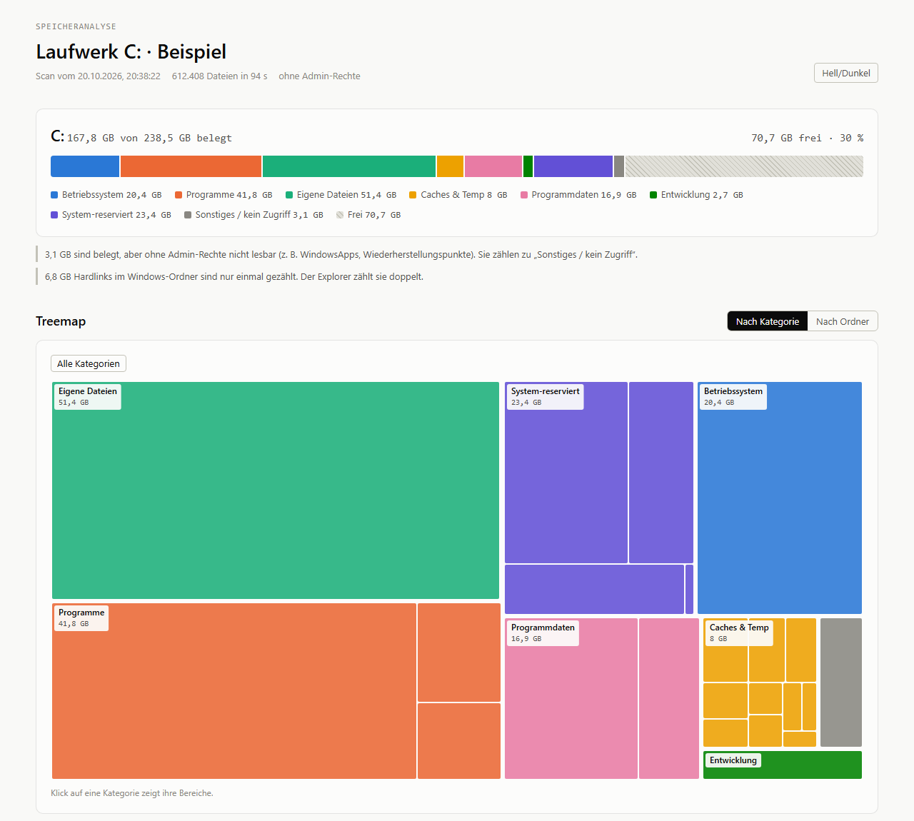
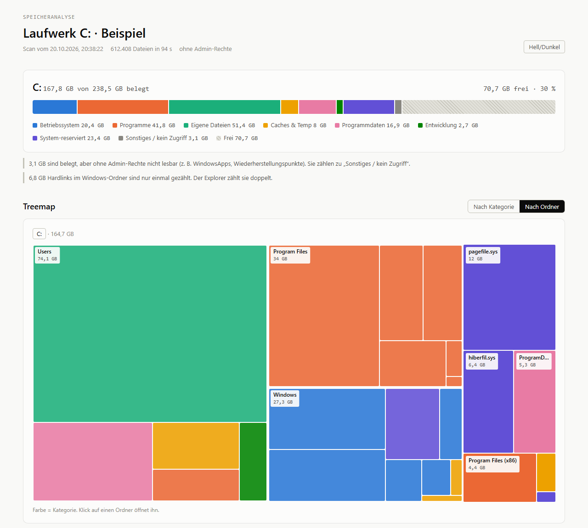

# Speicheranalyse

Zeigt, **was den Speicherplatz eines Windows-Laufwerks belegt**: Betriebssystem, Programme, eigene Dateien, Caches, Programmdaten und mehr, als interaktive Treemap im Browser. Funktioniert für die Systemplatte genauso wie für USB-Sticks und externe Festplatten. Nur Python-Standardbibliothek, keine Installation von Paketen, keine Internetverbindung, nichts verlässt den Rechner.



> **English:** *Speicheranalyse* ("storage analysis") is a Windows disk usage analyzer. It scans a drive (system disk or USB stick), sorts everything into categories — operating system, programs, personal files, caches, app data, development, system-reserved — and renders an offline HTML report with an interactive treemap, a reconciliation against the numbers Windows reports, a comparison with the previous scan and a cleanup list with instructions. It never deletes anything. Requirements: Windows 10/11 and Python 3.10+, no third-party packages. The user interface and documentation are in German. Quick start: `python app.py`.

**[Beispielbericht ansehen](https://htmlpreview.github.io/?https://github.com/loupdethies/speicheranalyse/blob/main/docs/beispiel.html)** (erfundene Daten)

## Funktionen

- **Acht Kategorien** mit farbenblind-tauglichem Farbschema, dazu eigene Dateien nach Typ (Bilder, Videos, Dokumente, CAD & Elektronik, …)
- **Treemap** nach Kategorie oder nach Ordner, mit Klick in jeden Ordner hinein
- **Abgleich mit Windows:** erklärt, warum Windows mehr „belegt“ meldet, als sich in Ordnern findet (NTFS-Dateitabelle, App-Pakete, Wiederherstellungspunkte, gesperrte Ordner)
- **Vergleich** mit dem vorherigen Scan: was ist seitdem gewachsen, was geschrumpft?
- **Aufräumliste** mit Einstufung („unbedenklich“ / „prüfen“) und Anleitung, z. B. Browser-Caches, Update-Reste, lange unbenutzte `node_modules`, alte Downloads. **Das Tool löscht nichts selbst.**
- **Größte Dateien**, **Hell-/Dunkelmodus**, Bericht als einzelne HTML-Datei, die auch offline funktioniert
- Genaue „Größe auf Datenträger“: Cluster-Rundung, komprimierte Dateien, OneDrive-Platzhalter, Hardlinks nur einmal gezählt



## Voraussetzungen

- Windows 10 oder 11
- [Python](https://www.python.org/downloads/windows/) 3.10 oder neuer (entwickelt mit 3.13). Bei der Installation „Add python.exe to PATH“ anhaken.
- Ein aktueller Browser (Chrome, Edge, Firefox)

## Installation

1. Projekt herunterladen: oben auf dieser Seite **Code → Download ZIP** und entpacken, oder
   ```powershell
   git clone https://github.com/loupdethies/speicheranalyse.git
   ```
2. Optional einen Eintrag im Startmenü anlegen (im Projektordner in PowerShell):
   ```powershell
   powershell -ExecutionPolicy Bypass -File .\verknuepfung.ps1
   ```

## Bedienung

Im Startmenü **Speicheranalyse** öffnen, oder im Projektordner:

```powershell
python app.py
```

Der Browser öffnet sich mit dem neuesten Bericht. Oben in der Leiste:

| Bedienelement | Funktion |
|---|---|
| **Laufwerk** | Systemplatte, weitere Platten und USB-Sticks |
| **mit Admin-Rechten** | Windows fragt per UAC nach. Dann werden auch gesperrte Ordner gelesen und Wiederherstellungspunkte gemessen. |
| **Neue Analyse** | Scan starten. C: dauert je nach Rechner 1–5 Minuten, ein USB-Stick meist Sekunden. |
| **Bericht** | Frühere Berichte öffnen, aller Laufwerke |
| **Beenden** | App beenden. Sie beendet sich auch von selbst, wenn der Tab geschlossen wird. |

Berichte landen in `berichte/` und lassen sich auch ohne App per Doppelklick öffnen.

## Kategorien

| Farbe | Kategorie | Beispiele |
|---|---|---|
| 🟦 | Betriebssystem | `C:\Windows` |
| 🟧 | Programme | `Program Files`, Store-Apps, `AppData\Local\Programs` |
| 🟩 | Eigene Dateien | `Dokumente`, `Bilder`, `Downloads`, Inhalte von USB-Sticks |
| 🟨 | Caches & Temp | Temp-Ordner, Browser-Caches, Update-Downloads, Papierkorb |
| 🩷 | Programmdaten | `AppData`, `ProgramData` |
| 🟩 (dunkel) | Entwicklung | `node_modules`, `.venv`, `.git`, Projektordner |
| 🟪 | System-reserviert | Auslagerungsdatei, Ruhezustand, Wiederherstellung, NTFS-Verwaltung |
| ⬜ | Sonstiges / kein Zugriff | Nicht zuordenbar oder ohne Admin-Rechte nicht lesbar |

Die genauen Farben (hell und dunkel) zeigt [docs/farbschema.html](docs/farbschema.html).

## Anpassen

- **`kategorien.json`:** Welcher Ordner in welche Kategorie fällt. Pfadregeln mit Platzhaltern (`*`, `?`) und Umgebungsvariablen (`%LOCALAPPDATA%`), Namensregeln (z. B. jeder Ordner `node_modules`) und die Dateitypen. Ein Ordner erbt die Kategorie seines Elternordners, bis eine Regel greift.
- **`aufraeumen.json`:** Einträge der Aufräumliste mit Titel, Einstufung und Anleitung sowie die Schwellen für „lange unverändert“ und „alte Downloads“.

## Ohne App (Kommandozeile)

Jeder Schritt ist auch einzeln aufrufbar:

```powershell
python scanner.py --root E:\     # Laufwerk scannen        -> scans/scan_E_<Zeit>.json
python classify.py               # Kategorien zuordnen     -> …_klassifiziert.json
python abgleich.py               # mit Windows abgleichen  -> …_abgleich.json
python report.py --open          # Bericht erzeugen        -> berichte/bericht_E_<Zeit>.html
```

`analyse.cmd [Laufwerk]` erledigt alle vier Schritte nacheinander. `python vergleich.py` und `python aufraeumen.py` geben Vergleich und Aufräumliste in der Konsole aus. Optionen zeigt jeweils `--help`.

## Wie gemessen wird

- **Größe auf Datenträger** statt Dateilänge: auf die Clustergröße aufgerundet. Komprimierte, Sparse- und Cloud-Dateien zählen mit ihrem echten Platz. Dateien bis ca. 600 Byte liegen bei NTFS in der Dateitabelle selbst und zählen dort.
- **Hardlinks** unter `C:\Windows` werden nur einmal gezählt. Der Explorer zählt sie pro Link, daher wirkt `C:\Windows` dort größer.
- **Junctions und symbolische Links** werden nicht verfolgt, sonst würde doppelt gezählt.
- **Ohne Admin-Rechte** sind einige Systemordner gesperrt. Der Abgleich weist ihren Platz trotzdem aus, als „gesperrte Ordner“.

## Datenschutz und Sicherheit

- Alles läuft lokal. Es gibt keine Netzwerkzugriffe nach außen und keine Telemetrie.
- Die App lauscht nur auf `127.0.0.1` und verlangt einen zufälligen Schlüssel aus der Start-URL, damit keine Website im Browser eine Analyse auslösen kann. Laufwerke werden gegen die tatsächliche Laufwerksliste geprüft.
- Admin-Rechte werden nur auf Wunsch und nur für den Analyse-Lauf angefordert, nicht für den Webserver.
- Scans und Berichte enthalten Datei- und Ordnernamen des eigenen Rechners. `.gitignore` schließt sie deshalb aus. **Berichte vor dem Weitergeben ansehen.**

## Grenzen

- Nur Windows (nutzt Windows-APIs über `ctypes`)
- Netzlaufwerke und optische Laufwerke werden nicht angeboten.
- Die Kategorien sind Regeln, keine Gewissheit. Ungewöhnliche Ordner landen unter Umständen in „Sonstiges“, das lässt sich in `kategorien.json` anpassen.
- Die Aufräumliste ist eine Empfehlung. Vor dem Löschen selbst prüfen.

## Projektstruktur

| Datei | Aufgabe |
|---|---|
| `app.py`, `app_leiste.js` | Lokale App: Webserver, Bedienleiste im Bericht |
| `scanner.py` | Laufwerk durchlaufen, Ordnerbaum als JSON |
| `classify.py`, `kategorien.json` | Kategorien und Dateitypen zuordnen |
| `abgleich.py` | Lücke zu den Windows-Werten erklären |
| `vergleich.py` | Mit dem vorherigen Scan vergleichen |
| `aufraeumen.py`, `aufraeumen.json` | Aufräumkandidaten finden |
| `report.py`, `bericht_vorlage.html` | HTML-Bericht erzeugen |
| `vendor/d3.min.js` | [D3](https://d3js.org) für die Treemap (ISC-Lizenz, siehe `vendor/LICENSE-d3.txt`) |
| `analyse.cmd`, `verknuepfung.ps1` | Starter ohne App, Startmenü-Eintrag |
| `docs/` | Screenshots, Beispielbericht (`beispiel_erzeugen.py`), Farbschema |

## Lizenz

[MIT](LICENSE). Die eingebettete Bibliothek D3 steht unter der [ISC-Lizenz](vendor/LICENSE-d3.txt).
